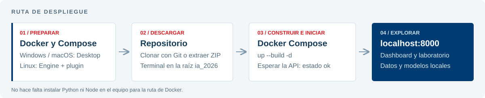
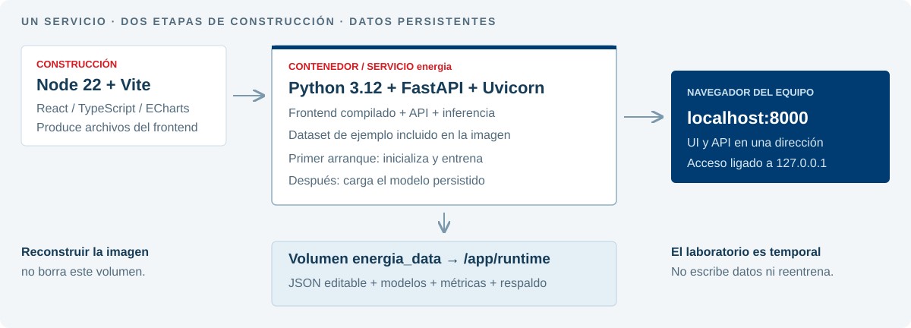

# Guía de despliegue desde cero

## Observatorio energético · Inteligencia Artificial Aplicada

**Ponentes:** Mateo Schreiber y Santiago López.

Esta guía lleva desde la instalación de Docker hasta la aplicación funcionando en **Windows, Linux o macOS**. El proyecto analiza anomalías en medidores y pronostica el pico diario por zona sobre **datos sintéticos**.

> **La aplicación actual se abre en http://localhost:8000.** No se inicia haciendo doble clic en el `index.html` de la raíz: ese archivo pertenece al prototipo histórico.

### Si ya tenés Docker y Git funcionando

Abrí una terminal. Si todavía no descargaste el repositorio:

~~~sh
git clone https://github.com/mateoschreiber/ia_2026.git
cd ia_2026
docker compose up --build -d
~~~

Si ya lo descargaste, entrá en su carpeta y ejecutá solo el último comando. Esperá a que termine el inicio del servicio y abrí **http://localhost:8000**. Si falla, seguí la guía desde la sección correspondiente.

### Recorrido de la guía

1. [Qué necesitás y qué instala Docker](#requisitos).
2. [Windows: Docker Desktop y WSL 2](#windows).
3. [Linux: Docker Engine y Compose](#linux).
4. [macOS: Docker Desktop](#macos).
5. [Descargar el código y ubicarse en la carpeta correcta](#codigo).
6. [Construir e iniciar por primera vez](#inicio).
7. [Comprobar que todo está listo](#comprobacion).
8. [Usar la aplicación](#uso).
9. [Entender Dockerfile y Docker Compose](#configuracion).
10. [Datos, modelos y copias de respaldo](#datos).
11. [Detener, volver a iniciar y actualizar](#operacion).
12. [Solución de problemas](#problemas).
13. [Pruebas y desarrollo opcional](#pruebas).
14. [Documentos de entrega y fuentes oficiales](#documentos).

## 1. Qué necesitás

| Elemento | Para qué sirve |
|---|---|
| Una computadora con sistema compatible | Ejecuta Docker y el navegador. Usar las versiones admitidas por el instalador oficial. |
| Docker Desktop o Docker Engine | Construye la imagen y ejecuta el servicio. |
| Docker Compose | Lee `docker-compose.yml` y organiza construcción, puerto y almacenamiento. Docker Desktop ya lo incluye; en Linux se instala el plugin. |
| Git o la descarga ZIP | Permite obtener el repositorio. Git conserva el historial y facilita actualizar. |
| Internet durante la instalación y primera construcción | Descarga Docker, imágenes base y paquetes del proyecto. |
| Navegador moderno | Abre el dashboard local. Las pruebas de este proyecto usan Chrome y Edge. |

Como orientación práctica para este proyecto, conviene disponer de **8 GB de RAM o más y unos 10 GB libres** para Docker, imágenes y construcción. Es una reserva recomendada, no un mínimo de rendimiento medido. Los requisitos exactos del producto Docker dependen de plataforma y versión.

**No necesitás instalar Python, Node.js, npm, una base de datos ni un servidor web en la computadora para usar la aplicación con Docker.** El Dockerfile prepara Node 22 para compilar la interfaz y Python 3.12 para ejecutar el servicio. No requiere GPU ni Kubernetes.

Usaremos `docker compose`, con espacio. El antiguo comando `docker-compose` con guion no es la ruta de esta guía. Ver [instalación oficial de Compose](https://docs.docker.com/compose/install/).

Los bloques `powershell` son para PowerShell de Windows. Los bloques `bash` son para Terminal de Linux/macOS. Los comandos `docker` y `git` indicados como `sh` sirven en las tres plataformas; en Linux puede ser necesario anteponer `sudo` según la configuración de permisos.

## 2. Windows: instalación y configuración

### 2.1. Comprobar el equipo

Esta ruta utiliza **Docker Desktop con motor WSL 2 y contenedores Linux**. Está orientada a Windows 11 de 64 bits compatible con la versión de Docker Desktop elegida. Docker señala 8 GB de RAM, virtualización por hardware y WSL 2.1.5 o posterior para ese backend. Para Windows 10, Windows ARM o ediciones concretas, revisar primero la [matriz oficial de requisitos y descargas](https://docs.docker.com/desktop/setup/install/windows-install/); no basta con que WSL pueda instalarse.

1. Abrir **Configuración → Sistema → Información** para identificar Windows y el tipo de sistema.
2. Abrir **Administrador de tareas → Rendimiento → CPU** y comprobar **Virtualización: habilitada**.
3. Si está deshabilitada, activar la virtualización en BIOS/UEFI siguiendo las instrucciones del fabricante.

### 2.2. Instalar o actualizar WSL 2

Abrir **PowerShell como administrador**. Comprobar:

~~~powershell
wsl --version
~~~

Si WSL no está instalado:

~~~powershell
wsl --install --no-distribution
~~~

Esta opción instala WSL sin agregar una distribución Ubuntu de usuario; no es necesaria para ejecutar Docker desde PowerShell. Reiniciar Windows cuando lo solicite. Después actualizar y establecer la versión predeterminada:

~~~powershell
wsl --update
wsl --set-default-version 2
wsl --version
~~~

Si ya tenías WSL, actualizarlo sin desinstalar sus distribuciones. Para consultar las existentes:

~~~powershell
wsl --list --verbose
~~~

La instalación de WSL y sus opciones están documentadas por Microsoft: [instalación](https://learn.microsoft.com/windows/wsl/install) y [comandos básicos](https://learn.microsoft.com/windows/wsl/basic-commands). Si Microsoft Store está bloqueada, Docker enlaza en su guía el instalador MSI oficial de WSL.

### 2.3. Descargar e instalar Docker Desktop

1. Entrar en la [página oficial de Docker Desktop para Windows](https://docs.docker.com/desktop/setup/install/windows-install/).
2. Elegir el instalador para la arquitectura del equipo; para la mayoría de equipos Intel/AMD es **x86_64**.
3. Ejecutar el instalador y conservar el backend **WSL 2**. Si la versión ofrece instalación por usuario y satisface el entorno, esa modalidad evita instalar para todas las cuentas.
4. Reiniciar si el instalador lo pide.
5. Abrir **Docker Desktop** desde Inicio, revisar los términos y continuar si se aceptan.
6. Esperar a que el motor indique que está en funcionamiento. Tener instalado el comando no significa que el motor esté iniciado.

### 2.4. Configuración para este proyecto

En Docker Desktop:

- En **Settings → General**, comprobar **Use the WSL 2 based engine**, si esa opción aparece en la versión instalada.
- Usar **Linux containers**. La imagen del proyecto es Linux.
- Si también vas a ejecutar comandos desde una distribución WSL, habilitar esa distribución en **Settings → Resources → WSL Integration**. Para esta guía desde PowerShell no es necesario.
- Mantener los recursos predeterminados inicialmente. Con WSL 2, algunos límites se gestionan desde WSL y no mediante los mismos controles de memoria de macOS.
- No hace falta activar Kubernetes, instalar extensiones ni exponer el daemon por TCP.

Consultar los nombres vigentes de las opciones en [configuración oficial de Docker Desktop](https://docs.docker.com/desktop/settings-and-maintenance/settings/).

### 2.5. Verificar Docker y Compose

Cerrar y abrir una nueva ventana de PowerShell normal, para actualizar el PATH:

~~~powershell
docker --version
docker compose version
docker version
docker info --format '{{.OSType}}'
docker run --rm hello-world
~~~

Resultados esperados: una versión del CLI, una versión de Compose, las secciones **Client** y **Server** de Docker, tipo de sistema **linux** y un mensaje de éxito de `hello-world`. La imagen de prueba se descarga la primera vez y el contenedor se elimina al terminar.

Si aparece únicamente Client o un error de conexión a una tubería de Docker, abrir Docker Desktop y esperar al motor. Después continuar en [descargar el código](#codigo).

## 3. Linux: instalación y configuración

La ruta principal usa **Docker Engine y el plugin Compose**, sin necesitar una aplicación gráfica ni una máquina virtual de Docker Desktop.

Primero identificar la distribución:

~~~bash
cat /etc/os-release
uname -m
~~~

Elegir **solo una** de las rutas siguientes. Están pensadas para instalaciones compatibles de Ubuntu/Debian o Fedora; para otra distribución seguir su [instalador oficial de Docker Engine](https://docs.docker.com/engine/install/). Si ya existe una instalación funcional, pasar a la verificación. Si hay paquetes Docker de otro origen o `podman-docker`, revisar los conflictos indicados en la guía oficial antes de reemplazarlos; no purgar datos o configuraciones de otros proyectos.

### 3.1. Ubuntu o Debian

Las fuentes oficiales describen [Ubuntu](https://docs.docker.com/engine/install/ubuntu/) y [Debian](https://docs.docker.com/engine/install/debian/). Verificar allí que la versión tenga soporte. No aplicar el bloque automáticamente a distribuciones derivadas.

**Paso A. Elegir el repositorio.** Para Ubuntu:

~~~bash
docker_distro=ubuntu
docker_suite=$(. /etc/os-release && printf '%s' "${UBUNTU_CODENAME:-$VERSION_CODENAME}")
~~~

Para Debian, ejecutar este bloque en su lugar:

~~~bash
docker_distro=debian
docker_suite=$(. /etc/os-release && printf '%s' "$VERSION_CODENAME")
~~~

**Paso B. En la misma terminal**, instalar los requisitos y registrar la clave y el repositorio oficial:

~~~bash
sudo apt update
sudo apt install -y ca-certificates curl git
sudo install -m 0755 -d /etc/apt/keyrings
sudo curl -fsSL "https://download.docker.com/linux/$docker_distro/gpg" -o /etc/apt/keyrings/docker.asc
sudo chmod a+r /etc/apt/keyrings/docker.asc

sudo tee /etc/apt/sources.list.d/docker.sources <<EOF
Types: deb
URIs: https://download.docker.com/linux/$docker_distro
Suites: $docker_suite
Components: stable
Architectures: $(dpkg --print-architecture)
Signed-By: /etc/apt/keyrings/docker.asc
EOF

sudo apt update
sudo apt install -y docker-ce docker-ce-cli containerd.io docker-buildx-plugin docker-compose-plugin
sudo systemctl enable --now docker
~~~

La clave permite verificar los paquetes; el repositorio proporciona Engine, el CLI, Buildx y Compose. El último comando inicia Docker y lo habilita al arrancar el sistema.

### 3.2. Fedora

Usar una versión mantenida admitida por la [guía oficial de Fedora](https://docs.docker.com/engine/install/fedora/). Los comandos siguientes corresponden al administrador de repositorios DNF actual:

~~~bash
sudo dnf install -y dnf-plugins-core git
sudo dnf config-manager addrepo --from-repofile https://download.docker.com/linux/fedora/docker-ce.repo
sudo dnf install -y docker-ce docker-ce-cli containerd.io docker-buildx-plugin docker-compose-plugin
sudo systemctl enable --now docker
~~~

Si DNF no reconoce `addrepo`, comprobar la versión y seguir la sintaxis indicada para ella en la fuente oficial, sin sustituirla por un script remoto.

### 3.3. Permisos y verificación

La opción inicial es usar `sudo` para los comandos de Docker:

~~~bash
sudo docker version
sudo docker compose version
sudo docker run --rm hello-world
~~~

Si elegís esta opción, anteponer `sudo` a los comandos `docker` del resto de la guía. Clonar el repositorio como usuario normal.

Para ejecutar Docker sin `sudo` de forma permanente:

~~~bash
sudo usermod -aG docker "$USER"
~~~

Cerrar completamente la sesión de usuario y volver a entrar. Después:

~~~bash
docker version
docker compose version
docker run --rm hello-world
~~~

La pertenencia al grupo `docker` concede privilegios equivalentes a root sobre Docker; es una decisión de administración del equipo. No resolver un error de permisos con `chmod 666 /var/run/docker.sock`. Ver [posinstalación oficial](https://docs.docker.com/engine/install/linux-postinstall/).

### 3.4. Si preferís Docker Desktop en Linux

Existe una [ruta oficial de Docker Desktop para Linux](https://docs.docker.com/desktop/setup/install/linux/). Usa una máquina virtual y requisitos propios. Para este proyecto no es obligatoria. Si se instala junto a Engine, comprobar `docker context ls`: cada contexto puede mostrar contenedores y volúmenes distintos.

No instalar un segundo Engine dentro de WSL para seguir la ruta Windows con Docker Desktop. Son alternativas de ejecución, no pasos que deban acumularse.

## 4. macOS: instalación y configuración

### 4.1. Elegir el instalador correcto

Abrir **menú Apple → Acerca de este Mac**:

- Si muestra un chip Apple M1/M2/M3/M4 u otro Apple silicon, elegir **Apple silicon**.
- Si muestra un procesador Intel, elegir **Intel**.

Docker Desktop admite la versión actual de macOS y las dos versiones mayores anteriores, y publica un mínimo de 4 GB de RAM. Para esta aplicación se recomienda la reserva práctica de recursos indicada al inicio. Comprobar la compatibilidad y descargar el DMG en la [página oficial para macOS](https://docs.docker.com/desktop/setup/install/mac-install/).

### 4.2. Instalar e iniciar

1. Abrir el archivo `Docker.dmg` descargado.
2. Arrastrar Docker a **Applications / Aplicaciones**.
3. Abrir **Docker.app** desde Aplicaciones.
4. Revisar los términos y completar las indicaciones del instalador si se aceptan.
5. Esperar a que Docker Desktop termine de iniciar.
6. Abrir una nueva ventana de Terminal para que encuentre las herramientas del CLI.

Mantener inicialmente las opciones recomendadas. No se necesita Kubernetes. Las imágenes del proyecto se seleccionan según la arquitectura disponible; no es necesario forzar `platform: linux/amd64` en Compose para usar un Mac Apple silicon.

### 4.3. Verificar

~~~bash
docker --version
docker compose version
docker version
docker info --format '{{.OSType}}'
docker run --rm hello-world
~~~

Esperar Client y Server, tipo **linux** y el mensaje de éxito de hello-world. Si el comando no se encuentra, abrir una Terminal nueva y comprobar la configuración de herramientas del CLI en Docker Desktop. Continuar con la descarga del repositorio.

## 5. Descargar el repositorio

### 5.1. Con Git — opción recomendada

Comprobar primero:

~~~sh
git --version
~~~

Si no está instalado:

- **Windows:** descargar y ejecutar el instalador desde [Git para Windows](https://git-scm.com/install/windows), habilitando su uso desde la línea de comandos. Abrir PowerShell de nuevo.
- **Ubuntu/Debian y Fedora:** los bloques anteriores ya incluyen Git.
- **macOS:** ejecutar `xcode-select --install` y completar la instalación de las herramientas de línea de comandos, o seguir otra opción de la [página oficial de Git para macOS](https://git-scm.com/install/mac).

En una carpeta donde quieras guardar el proyecto:

~~~sh
git clone https://github.com/mateoschreiber/ia_2026.git
cd ia_2026
~~~

Si el repositorio requiere autenticación, usar una cuenta con acceso mediante el método de GitHub disponible. No poner contraseñas ni tokens dentro de la URL.

### 5.2. Sin Git — descargar ZIP

1. Abrir el [repositorio en GitHub](https://github.com/mateoschreiber/ia_2026).
2. Elegir **Code → Download ZIP**, estando en la rama `main`.
3. Extraer el ZIP por completo. No ejecutar comandos dentro del archivo comprimido.
4. Para seguir los ejemplos, nombrar la carpeta extraída `ia_2026` y abrir una terminal dentro de ella.

Un ZIP permite usar el sistema, pero no incluye el historial Git ni permite `git pull`. Para la entrega con historial se recomienda clonar.

### 5.3. Confirmar la carpeta correcta

En Windows, por ejemplo:

~~~powershell
cd "C:\ruta\donde\guardaste\ia_2026"
Get-Location
Get-ChildItem Dockerfile, docker-compose.yml
~~~

En Linux/macOS:

~~~bash
cd "/ruta/donde/guardaste/ia_2026"
pwd
ls Dockerfile docker-compose.yml
~~~

Reemplazar la ruta de ejemplo por la real. Deben aparecer **Dockerfile** y **docker-compose.yml**. Todos los comandos `docker compose` siguientes se ejecutan desde esta carpeta, no desde `src/` ni `web/`.

## 6. Primera construcción e inicio

### 6.1. Validar la configuración

~~~sh
docker compose config --quiet
~~~

Si termina sin errores, Compose pudo interpretar el archivo. Esto todavía no construye ni inicia la aplicación.

### 6.2. Construir e iniciar

~~~sh
docker compose up --build -d
~~~

| Parte del comando | Significado |
|---|---|
| `compose` | Usa el archivo de servicios del repositorio. |
| `up` | Crea o actualiza e inicia el contenedor y su red. |
| `--build` | Construye la imagen con el código de esta carpeta. |
| `-d` | Deja el servicio en segundo plano; podés cerrar la terminal. |

Durante la primera ejecución:

1. Docker descarga las imágenes base de Node y Python.
2. Compila React/TypeScript y sus gráficos.
3. Instala las dependencias Python.
4. Crea el contenedor y el volumen persistente.
5. Al iniciar el servicio, copia el dataset de ejemplo y entrena los modelos si todavía no existen en el volumen.

La duración depende de la red, la arquitectura y el equipo. **El retorno del comando no garantiza que el primer entrenamiento ya terminó.** No cerrar Docker Desktop mientras se usa el sistema. Ver [comportamiento de compose up](https://docs.docker.com/reference/cli/docker/compose/up/).

### 6.3. Mirar el progreso

~~~sh
docker compose logs -f --tail 50 energia
~~~

Esperar el mensaje **Application startup complete**. Para salir de esta vista de logs usar **Ctrl+C**: se cierra el seguimiento, pero el contenedor iniciado con `-d` continúa funcionando.

Alternativamente, `docker compose up --build` sin `-d` muestra los logs en primer plano; en ese modo Ctrl+C sí detiene los contenedores.

## 7. Comprobar que está listo

### 7.1. Estado del contenedor

~~~sh
docker compose ps
~~~

Debe mostrar el servicio **energia**, estado **Up** y un mapeo semejante a `127.0.0.1:8000->8000/tcp`. Up indica que el proceso está ejecutándose; comprobar también la API.

### 7.2. Estado de la API

**PowerShell:**

~~~powershell
Invoke-RestMethod http://127.0.0.1:8000/api/health
~~~

**Linux/macOS:**

~~~bash
curl --fail http://127.0.0.1:8000/api/health
~~~

Respuesta esperada:

~~~json
{"status":"ok","synthetic":true,"model":"distance"}
~~~

El nombre del modelo corresponde al experimento incluido. Si la API todavía no responde, revisar los logs y esperar al inicio; si hay una excepción, consultar [solución de problemas](#problemas).

### 7.3. Abrir el navegador

Entrar en **http://localhost:8000** o **http://127.0.0.1:8000**. Escribir `http://`; no usar `https://` para este servicio local.

Debe aparecer **Supervisión de la red**, el distintivo de datos simulados y el contexto de zona, transformador y medidor. El análisis de referencia se solicita automáticamente. Si una pestaña conserva una versión anterior, recargarla.

## 8. Primera prueba de funcionamiento

1. En **Supervisión**, seleccionar una zona, un transformador y un medidor. Consultar la red lógica, la demanda histórica y las alertas filtradas.
2. En **Anomalías**, revisar perfil horario, mapa de calor, score, umbral y contribuciones de variables. Cambiar el árbol de Isolation Forest para ver otro recorrido real.
3. En **Demanda**, observar las tres entradas del modelo, el pico del día siguiente y las predicciones de los árboles.
4. Abrir **Laboratorio**, elegir un caso guiado y pulsar **Comparar escenario**. El cambio es temporal: no escribe el dataset ni reentrena modelos.
5. Descartar el escenario y abrir **Evaluación y método** para ver las métricas del experimento reservado.
6. Para exponer, activar **Modo exposición** y recorrer sus seis pasos.

**Gestión de datos** permite importar/exportar JSON y editar registros. Las ediciones persistentes invalidan los resultados y la interfaz solicita el análisis nuevo. **Restaurar** reemplaza la base de trabajo por el ejemplo; exportar antes si querés conservar cambios.

| Dirección | Contenido |
|---|---|
| http://localhost:8000 | Aplicación. |
| http://localhost:8000/api/health | Disponibilidad del servicio. |
| http://localhost:8000/api/metrics | Métricas del experimento de referencia. |
| http://localhost:8000/openapi.json | Esquema local de la API REST. |
| http://localhost:8000/docs | Swagger UI interactivo; requiere internet para cargar sus recursos CDN. |

La aplicación y la API trabajan localmente después de construir la imagen. Las fuentes bibliográficas, GitHub, las actualizaciones y Swagger UI pueden necesitar conexión. El sistema no es una herramienta operativa de ANDE y un score no confirma fraude.

## 9. Cómo está configurado Docker

### 9.1. Dockerfile: construcción en dos etapas

| Etapa | Qué hace | Por qué |
|---|---|---|
| `node:22-slim` | Instala con npm ci y compila el frontend con Vite y TypeScript. | El navegador recibe archivos construidos; no hace falta Node en la computadora del usuario. |
| `python:3.12-slim` | Instala requirements.txt, copia backend, frontend compilado y dataset inicial. | Reúne la aplicación en una imagen de ejecución. |
| Usuario `app` | Ejecuta Uvicorn como usuario sin privilegios de administrador dentro del contenedor. | La escritura de trabajo se concentra en /app/runtime. |
| Uvicorn, puerto interno 8000 | Sirve FastAPI y los archivos del frontend. | Una URL local permite usar interfaz y API. |

No necesitás modificar el Dockerfile para un despliegue normal. `.dockerignore` evita enviar al contexto de construcción carpetas locales como entornos Python, node_modules y cachés.

### 9.2. docker-compose.yml: servicio, puerto y volumen

La configuración del repositorio es:

~~~yaml
services:
  energia:
    build: .
    ports:
      - "127.0.0.1:8000:8000"
    volumes:
      - energia_data:/app/runtime
    restart: unless-stopped
volumes:
  energia_data:
~~~

- **energia:** nombre del servicio, usado en logs, exec y pruebas.
- **build: .:** construye usando esta carpeta y su Dockerfile.
- **127.0.0.1:8000:8000:** publica el puerto interno 8000 como puerto 8000 de esta computadora. No lo abre a la red local.
- **energia_data:** volumen administrado por Docker, montado en /app/runtime.
- **unless-stopped:** permite reiniciar el contenedor cuando el motor vuelve a iniciarse, salvo que se haya detenido explícitamente.

No hace falta crear un archivo `.env`, configurar credenciales, instalar una base externa ni descargar modelos de terceros. El servicio está diseñado para demostración local y no incorpora autenticación de usuarios.

El puerto 8000 también aparece en la validación de origen de la API. **Cambiar solo el mapeo a otro puerto no completa la adaptación:** las operaciones de escritura pueden ser rechazadas. Para esta guía usar 8000 y resolver el conflicto con el servicio propio que lo ocupa.

## 10. Dónde se guardan los datos y cómo respaldarlos

### 10.1. Dataset inicial y base de trabajo

| Ubicación | Función |
|---|---|
| `data/database.json` en el repositorio | Ejemplo original incluido en la imagen. |
| `/app/runtime/database.json` en el volumen | Base editable utilizada por el servicio. |
| `/app/runtime/model.joblib` | Modelos, escaladores, umbrales y evaluación persistidos. |
| `/app/runtime/metrics.json` | Copia de las métricas del artefacto. |
| `/app/runtime/model.v1.backup.joblib`, si existe | Respaldo creado al migrar la versión anterior del modelo. |

Editar la base en la interfaz no modifica el archivo original del repositorio. Reconstruir la imagen o usar `docker compose down` sin opciones de borrado no elimina el volumen. Ver [volúmenes de Docker](https://docs.docker.com/engine/storage/volumes/).

Compose suele prefijar el nombre del volumen con el nombre del proyecto; con la carpeta `ia_2026` será normalmente `ia_2026_energia_data`. Cambiar el nombre de la carpeta o usar otro `-p` puede seleccionar otro volumen y mostrar una base nueva. No es evidencia por sí sola de que se borró el anterior.

### 10.2. Respaldo de datos desde la interfaz

En **Gestión de datos → Exportar**, descargar el JSON y guardarlo fuera de la carpeta de trabajo. Para recuperarlo, iniciar la aplicación y usar **Importar JSON**. El servidor lo valida antes de guardarlo.

Las series importadas deben tener el mismo inicio e intervalo horario que el clima y entre 14 y 366 días completos. El [diccionario de datos](docs/METODOLOGIA.md) explica campos y unidades.

### 10.3. Copiar también los artefactos del volumen

Para una copia consistente, dejar de editar datos y detener temporalmente el servicio. Elegir un directorio nuevo para cada respaldo:

~~~sh
docker compose stop
docker compose cp energia:/app/runtime/. ./respaldo-observatorio
docker compose up -d
~~~

`compose cp` copia los archivos del contenedor a una carpeta local y también puede trabajar con su contenedor detenido. El respaldo contiene datos y modelos; no subirlo por accidente al repositorio. La carpeta de ejemplo queda excluida por los archivos de ignore. Referencia: [docker compose cp](https://docs.docker.com/reference/cli/docker/compose/cp/).

Para recuperar el uso en una instalación nueva, iniciar normalmente e importar el `database.json` respaldado desde Gestión. Los modelos de referencia se generan en el primer arranque del nuevo volumen. Conservar los artefactos originales como evidencia del experimento; no cargar archivos joblib de origen desconocido.

**No usar `docker compose down -v` ni borrar el volumen para una detención normal:** esas acciones eliminan el almacenamiento persistente. No se requiere limpiar globalmente Docker para actualizar este proyecto.

## 11. Uso diario, detención y actualización

Todos estos comandos se ejecutan desde la raíz del repositorio:

| Acción | Comando |
|---|---|
| Iniciar una instalación ya construida | `docker compose up -d` |
| Consultar estado | `docker compose ps` |
| Ver últimos mensajes | `docker compose logs --tail 50 energia` |
| Seguir mensajes nuevos | `docker compose logs -f energia` |
| Detener y conservar contenedor/volumen | `docker compose stop` |
| Volver a arrancar el contenedor detenido | `docker compose start` |
| Reiniciar el proceso del servicio | `docker compose restart energia` |
| Detener y retirar contenedor/red, conservando el volumen | `docker compose down` |
| Reconstruir tras cambiar código o dependencias | `docker compose up --build -d` |

En Windows/macOS, si Docker Desktop está cerrado, iniciarlo antes de esos comandos. Cerrar únicamente el navegador no detiene el servicio.

### Actualizar desde Git

Exportar los datos que quieras conservar y comprobar que no hay cambios locales pendientes:

~~~sh
git status
git pull --ff-only
docker compose up --build -d
~~~

Si Git informa modificaciones o conflictos, resolverlos antes de actualizar; no sobrescribirlos con un reset forzado. La imagen se actualiza y el volumen permanece. Las migraciones del artefacto conservan un respaldo y comprueban la evaluación publicada.

Si descargaste un ZIP, no disponés de git pull: obtener la nueva versión y mantener control sobre la carpeta/nombre de proyecto y el respaldo de datos.

## 12. Solución de problemas

| Síntoma | Qué comprobar y cómo continuar |
|---|---|
| `docker` no se reconoce | Abrir una terminal nueva tras instalar. Comprobar que Docker Desktop quedó instalado y que sus herramientas CLI están en PATH. |
| `docker compose` no existe | Desktop ya lo incluye; actualizar/reparar su instalación. En Engine Linux, instalar docker-compose-plugin desde el repositorio oficial configurado. |
| Error de conexión al daemon, socket o dockerDesktopLinuxEngine | En Windows/macOS iniciar Docker Desktop y esperar; en Engine Linux revisar `sudo systemctl status docker` e iniciar con `sudo systemctl start docker`. |
| Windows informa WSL antiguo | Ejecutar `wsl --version` y `wsl --update`; revisar virtualización y reinicios pendientes. |
| Error de permisos en /var/run/docker.sock | En Linux usar sudo o configurar el grupo docker y volver a iniciar sesión. No abrir permisos del socket globalmente. |
| `no configuration file provided` | La terminal está en otra carpeta. Volver a la raíz donde están Dockerfile y docker-compose.yml. |
| Puerto 8000 ocupado | Consultar el propio `docker compose ps` y otros servicios locales. Si ya está esta aplicación iniciada, abrirla. Detener solo el servicio propio identificado que entra en conflicto. |
| Windows: identificar quién escucha en 8000 | PowerShell: `Get-NetTCPConnection -LocalPort 8000 -State Listen`; el campo OwningProcess permite investigar el proceso. No terminar procesos sin identificarlos. |
| Linux/macOS: identificar el puerto | Usar `lsof -nP -iTCP:8000 -sTCP:LISTEN` si está instalado; Linux también puede usar `ss -ltnp`. |
| Página no disponible aunque el contenedor está Up | Consultar logs y /api/health; el entrenamiento inicial puede seguir en curso. |
| Se abre la interfaz antigua | No abrir el index.html de la raíz; usar http://localhost:8000 y recargar la pestaña. |
| Error durante descarga de imagen o paquetes | Comprobar internet, DNS y proxy corporativo. Configurar el proxy en Docker Desktop según la documentación; no desactivar TLS. Volver a ejecutar up --build. |
| Proceso terminado o memoria insuficiente | Revisar logs, memoria y espacio disponible. Cerrar cargas ajenas o ampliar los recursos de Docker/WSL mediante los ajustes oficiales. |
| Mensaje sobre umbral o validación del JSON | Ver campos, relaciones, valores finitos, fechas e intervalos en [METODOLOGIA.md](docs/METODOLOGIA.md). |
| HTTP 403 al guardar con un puerto cambiado | Usar localhost:8000; la API restringe orígenes y el cambio de puerto requiere una adaptación de código. |
| La base parece reiniciada después de mover la carpeta | Revisar el nombre de proyecto/contexto y sus volúmenes; podría haberse creado otro volumen. Recuperar el JSON exportado si corresponde. |
| /docs no carga sin internet | Usar /openapi.json; Swagger UI descarga recursos externos, mientras que el dashboard está empaquetado localmente. |

Para informar un problema, aportar el sistema/arquitectura, salida de `docker version`, `docker compose version` y los últimos logs del servicio. No incluir contraseñas, tokens ni datos personales.

## 13. Pruebas y desarrollo opcional

### Pruebas de API dentro de Docker

Con la imagen construida, ejecutar desde la raíz:

~~~sh
docker compose run --rm --no-deps -v "./test:/app/test:ro" --entrypoint python energia -m pytest -q -p no:cacheprovider test/test_system.py
~~~

El comando crea un contenedor temporal, monta las pruebas como lectura y las ejecuta con datos temporales. Comprueba validación, particiones, explicaciones, laboratorio y migración. El contenedor de pruebas se retira al terminar.

### Pruebas de navegador y persistencia

Los scripts del directorio `test/` se explican en [ENTREGA.md](docs/ENTREGA.md). Las pruebas de navegador están preparadas para Chrome/Edge instalados en Windows y requieren Playwright para Python en el equipo; no son necesarias para el uso normal con Docker. La prueba de edición y la de persistencia restauran la base original: no editarla simultáneamente desde otra ventana.

### Desarrollo sin reconstruir todo Docker

Solo para quien vaya a modificar código: instalar Python 3.12 y una versión de Node compatible con Vite. El Dockerfile utiliza Node 22. Crear un entorno Python, instalar `requirements.txt` y construir la interfaz antes de servirla localmente.

**Windows:**

~~~powershell
python -m venv .venv
.venv\Scripts\python -m pip install -r requirements.txt
cd web
npm ci
npm run build
cd ..
.venv\Scripts\python -m uvicorn backend.api:app --host 127.0.0.1 --port 8000
~~~

**Linux/macOS:**

~~~bash
python3.12 -m venv .venv
.venv/bin/python -m pip install -r requirements.txt
cd web
npm ci
npm run build
cd ..
.venv/bin/python -m uvicorn backend.api:app --host 127.0.0.1 --port 8000
~~~

Detener previamente el servicio Docker de este proyecto para no ocupar el mismo puerto. La ejecución local usa `runtime/`, un directorio distinto del volumen Docker; no se sincronizan automáticamente.

Para reproducir el experimento ejecutar el módulo `backend.experiment` con el Python del entorno. Ese comando actualiza `docs/resultados_experimento.json`; no es necesario para iniciar la aplicación y sus tiempos medidos pueden variar. La metodología y los resultados de referencia están documentados.

## 14. Documentos del proyecto y alcance de verificación

| Documento | Contenido |
|---|---|
| [Lista de entrega](docs/ENTREGA.md) | Criterios, evidencias y comprobaciones. |
| [Informe IEEE](docs/informe_ieee.pdf) · [fuente editable](docs/informe_ieee.tex) | Tres páginas, resultados, referencias y glosario. |
| [Defensa](docs/DEFENSA.md) | Diez minutos de exposición/demo y dos de preguntas. |
| [Metodología y diccionario](docs/METODOLOGIA.md) | Procedencia sintética, unidades, particiones y límites. |
| [Guía de algoritmos y componentes](docs/GUIA_ALGORITMOS.md) | Qué hace cada modelo y cómo leer los gráficos. |
| [Resultados](docs/resultados_experimento.json) | Predicciones y métricas guardadas. |
| [Verificación de fuentes científicas](docs/FUENTES_VERIFICADAS.md) | Referencias institucionales y técnicas comprobadas. |

**Código actual:** backend en `backend/`, frontend en `web/` y datos/generador en `data/` y `generator/`. El código de `src/`, `assets/`, el index.html de la raíz y test/run-tests.js es un antecedente histórico; no es otra forma de iniciar la entrega actual.

La ejecución real del proyecto se verificó en **Windows con Docker Desktop y contenedores Linux**, incluyendo API, navegadores y persistencia. Las instrucciones de instalación de Linux y macOS se contrastaron con sus fuentes oficiales; **no se afirma haber instalado esos sistemas anfitriones en este equipo**.

Las fuentes de instalación citadas se revisaron el **9 de noviembre de 2026**. Requisitos y pantallas de Docker pueden cambiar: ante diferencias, consultar la página oficial de la plataforma, manteniendo la configuración del proyecto.

La defensa en vivo y la evidencia de las ocho semanas de trabajo corresponden a los estudiantes. Los datos del sistema son simulados y no acreditan desempeño operativo en la red de ANDE.
