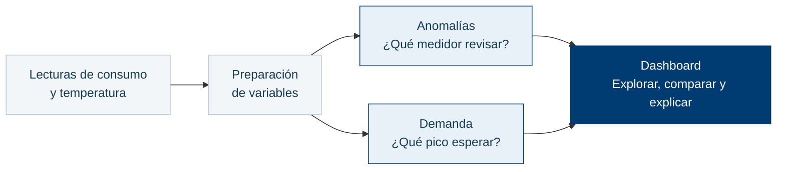

# Observatorio energético

Aplicación web de **Inteligencia Artificial Aplicada** para explorar el consumo eléctrico, detectar comportamientos anómalos en medidores y estimar picos de demanda por zona. Es un proyecto de investigación inspirado en los desafíos de supervisión energética de Paraguay.

## ¿Qué hace?

| Función | Qué permite observar |
|---|---|
| **Supervisión de la red** | Zonas, transformadores, medidores, consumo histórico y alertas de carga o balance energético. |
| **Detección de anomalías** | Puntuaciones que ayudan a priorizar medidores para revisión, con explicaciones de las variables y los árboles utilizados. |
| **Pronóstico de demanda** | Pico diario esperado por zona a partir de una temperatura hipotética y los picos de días anteriores. |
| **Laboratorio interactivo** | Comparación del consumo original con cambios temporales, sin modificar la base ni reentrenar los modelos. |
| **Evaluación** | Comparación de modelos, matriz de confusión y métricas de detección y pronóstico. |

### Del dato al resultado

La detección compara **Isolation Forest y distancia estandarizada**; el pronóstico compara **Random Forest y regresión Ridge polinómica**. Los modelos se seleccionan con validación y se evalúan en conjuntos reservados. El dashboard muestra tanto sus resultados como sus limitaciones.

## ¿Para qué podría utilizarse?

- **Formación y demostraciones:** comprender cómo los algoritmos convierten lecturas eléctricas en señales y pronósticos.
- **Investigación:** comparar métodos y explorar escenarios de consumo y temperatura.
- **Base para un piloto de supervisión:** orientar inspecciones y estudiar demanda, previa integración de mediciones reales y validación con especialistas.

> **Alcance actual:** utiliza datos sintéticos de 100 medidores durante un año. No está conectado a ANDE ni validado en su red; una anomalía no confirma fraude y la temperatura futura se introduce como escenario.

**Tecnologías:** Python y scikit-learn · FastAPI · React y TypeScript · Apache ECharts · Docker Compose.

Más información: [metodología y datos](docs/METODOLOGIA.md) · [guía de algoritmos](docs/GUIA_ALGORITMOS.md) · [informe IEEE](docs/informe_ieee.pdf).

---

## 1. Instalar los requisitos

| Sistema | Instalación |
|---|---|
| Windows | [Docker Desktop](https://docs.docker.com/desktop/setup/install/windows-install/) con WSL 2 y contenedores Linux. Incluye Compose. |
| Linux (Ubuntu) | [Docker Engine y plugin Docker Compose](https://docs.docker.com/engine/install/ubuntu/). |
| Debian | [Docker Engine y plugin Docker Compose](https://docs.docker.com/engine/install/debian/). |
| macOS | [Docker Desktop](https://docs.docker.com/desktop/setup/install/mac-install/), para Apple silicon o Intel. Incluye Compose. |

Iniciar Docker y comprobar:

~~~sh
docker version
docker compose version
~~~

Docker debe mostrar **Client y Server**. No hace falta instalar Python ni Node.js.

## 2. Descargar el repositorio

Con [Git instalado](https://git-scm.com/install/):

~~~sh
git clone https://github.com/mateoschreiber/ia_2026.git
cd ia_2026
~~~

Si ya está descargado, abrir una terminal en la carpeta que contiene `docker-compose.yml`.

## 3. Ejecutar todo con un comando

~~~sh
docker compose up --build -d
~~~

Esperar el inicio y abrir **http://localhost:8000**.

El comando construye la interfaz, prepara la API e inicializa los datos y modelos. La primera ejecución requiere internet.

## Comandos básicos

| Acción | Comando |
|---|---|
| Ver estado | `docker compose ps` |
| Ver logs | `docker compose logs -f energia` |
| Detener sin borrar datos | `docker compose down` |
| Volver a iniciar | `docker compose up -d` |

En Linux/Debian, anteponer `sudo` si el usuario no tiene permisos para Docker.
