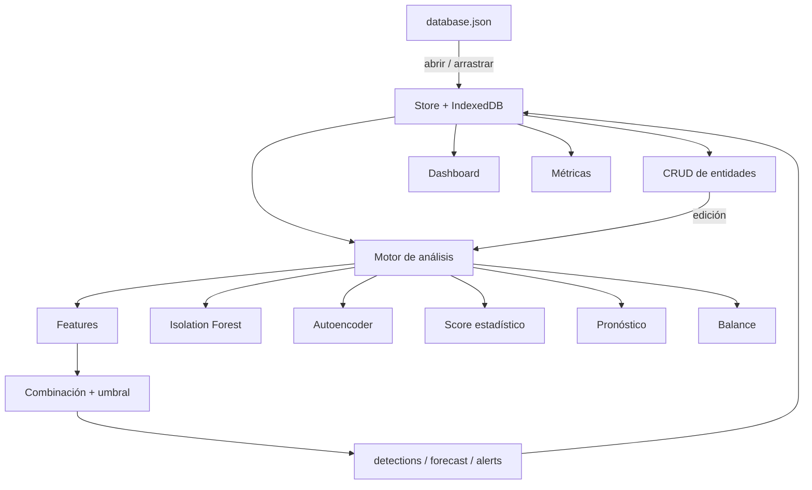

# Documentación técnica

**Proyecto Final — Inteligencia Artificial**
*Predicción de picos de consumo eléctrico y detección de pérdidas no técnicas*

> Sistema de supervisión energética sobre datos **emulados** (contexto ANDE),
> implementado como aplicación 100 % estática (HTML + CSS + JavaScript).

---

## Resumen ejecutivo

El proyecto resuelve dos problemas clásicos de una distribuidora eléctrica:

1. **Predicción de la demanda máxima** por zona en días de calor extremo, para
   anticipar sobrecargas de transformadores.
2. **Detección de pérdidas no técnicas (NTL)**, es decir, energía consumida y no
   facturada por fraude, conexiones clandestinas o fallas de medidor.

La solución combina **ingeniería de features** sobre series horarias, tres
detectores de anomalías (**Isolation Forest**, **autoencoder** y un score
**estadístico**), un **modelo de pronóstico** de pico basado en temperatura y un
**balance energético** suministrado-vs-facturado. Todo corre en el navegador,
sin servidor, con resultados reproducibles.

**Resultado principal (datos emulados):** con 100 medidores y 7 con pérdida no
técnica, el sistema detecta los 3 arquetipos "evidentes" en el *top 10*
(`precision@10 = 0.30`, frente a `0.07` esperado por azar; `recall@30 = 0.71`).
Los arquetipos sutiles (escalado uniforme, intermitente, defecto de medidor) son
intrínsecamente más difíciles, lo que coincide con la literatura y con la
práctica industrial.

---

## 1. Contexto y problema

### 1.1 Pérdidas técnicas y no técnicas

En la distribución de energía se distinguen dos tipos de pérdidas:

- **Técnicas (TL):** inevitables, asociadas a la física (efecto Joule en
  conductores y transformadores). Suelen representar un 4–8 % de la energía.
- **No técnicas (NTL):** energía entregada pero no facturada. Incluyen:
  - conexión directa ("colgado") antes del medidor;
  - *bypass* total o parcial del medidor;
  - manipulación del medidor (inversión de fase, frenado, imán);
  - error de lectura o facturación;
  - medidor defectuoso que subregistra.

La diferencia entre energía suministrada y facturada es la señal observable:

$$
\text{pérdidas} = E_{\text{suministrada}} - E_{\text{facturada}}
= \text{TL} + \text{NTL}
$$

### 1.2 Picos de demanda

En verano, el uso masivo de aire acondicionado eleva la demanda en las horas
centrales y nocturnas. Si un transformador supera su capacidad, aparecen
caídas de tensión, recalentamiento y cortes. Predecir el **pico** con días de
anticipación permite gestionar carga, reforzar la red o programar
mantenimiento.

### 1.3 Por qué es un problema difícil

| Dificultad | Consecuencia |
|---|---|
| **Desbalance extremo** | El fraude es el 2–10 % de los clientes; un modelo que diga "todos normales" acierta >90 % y es inútil. |
| **Etiquetas escasas y ruidosas** | Las etiquetas solo se obtienen inspeccionando en campo, lo que es caro y lento. |
| **Cambio de concepto (drift)** | Estacionalidad, nuevas cargas (criptominería, vehículos eléctricos), cambios tarifarios. |
| **Adversarial** | El defraudador adapta su comportamiento si detecta el patrón de control. |
| **Escala** | AMI con lectura cada 15 min produce millones de puntos por día. |
| **Legal y ético** | Un falso positivo puede derivar en una acusación injusta. El modelo **prioriza inspecciones**, no condena. |

---

## 2. Formulación del problema

### 2.1 Detección de NTL

Se trabaja como **detección de anomalías no supervisada** con etiquetas usadas
**solo para evaluar**:

- Cada medidor $i$ se representa por un vector de features
  $\mathbf{x}_i \in \mathbb{R}^{11}$ extraído de su serie horaria.
- Los detectores producen un **score** $s_i \in [0,1]$ (mayor = más anómalo).
- Se ordenan los medidores por score y se inspeccionan los primeros $k$.
- Las etiquetas `labels` (ground truth) permiten medir `precision@k` y `recall`.

Esto refleja la realidad: en producción **casi nunca hay etiquetas**; el modelo
ordena candidatos y las inspecciones generan etiquetas con el tiempo.

### 2.2 Pronóstico de pico

Para cada zona $z$ y día $d$:

$$
\text{pico}_{z,d} = \max_{h \in \text{horas del día}} \text{carga}_{z,d,h}
$$

Se modela el pico diario en función de la temperatura máxima del día y se
reporta el **percentil 95** (escenario adverso), no la media.

### 2.3 Métricas adecuadas al problema

| Métrica | Qué mide | Por qué |
|---|---|---|
| `precision@k` | Fraudes entre los $k$ primeros | Es el costo real: inspectores limitados. |
| `recall` | Fraudes hallados sobre el total | Cobertura del riesgo. |
| Curva de inspección | Fraudes acumulados vs revisados | Muestra el retorno de cada inspección. |
| Matriz de confusión | TP/FP/FN/TN | Comunica errores y costos. |

**No se usa accuracy** como métrica principal: con 7 % de fraude, un modelo
trivial obtiene 93 %.

---

## 3. Datos emulados

### 3.1 Por qué datos sintéticos

No existe acceso público a datos AMI de ANDE ni a etiquetas de fraude. Trabajar
con datos emulados permite:

- **controlar el ground truth** (sabemos qué medidor es fraudulento y de qué tipo);
- **experimentar** con arquetipos y niveles de ruido;
- **reproducir** el experimento (semilla fija).

**Costo:** los resultados no miden desempeño real; miden el comportamiento del
método en un banco de pruebas controlado. Esto se declara explícitamente.

### 3.2 Modelo generativo

Para cada medidor, el consumo horario se genera como:

$$
\text{kWh}(t) = B \cdot P(\text{hora}) \cdot S(\text{día}) \cdot T(\text{temp}_t) \cdot (1 + \varepsilon_t)
$$

donde:

- $B$: carga base del medidor (varía por tipo de cliente y por medidor);
- $P(h)$: perfil horario (residencial con pico 18–22 h; comercial 8–20 h;
  industrial más plano);
- $S(d)$: factor estacional (máximo en enero, mínimo en julio);
- $T(\tau) = 1 + \alpha \max(0, \tau - 25)^2$: **respuesta térmica no lineal**
  (el aire acondicionado dispara el consumo por encima de ~25 °C);
- $\varepsilon_t$: ruido autorregresivo AR(1), para que la serie no sea
  independiente en el tiempo.

El clima se genera con ciclo anual, ciclo diario, **olas de calor** y ruido.

### 3.3 Arquetipos de fraude

El generador crea primero el consumo **real** y luego el **registrado** (lo que
el medidor reporta). Para un cliente honesto son iguales; para uno fraudulento
se aplica una transformación:

| Arquetipo | Transformación sobre lo registrado | Firma | Detectabilidad |
|---|---|---|---|
| `bypass_total` | consumo ≈ 0 | serie casi nula | muy alta |
| `bypass_parcial` | $\times 0.50\text{–}0.65$ | todo reducido, forma intacta | media |
| `inversion_fase` | serie plana artificial | `cv` muy bajo | alta |
| `manipulacion_nocturna` | $\times 0.2\text{–}0.35$ en 00–06 h | caída nocturna | alta |
| `conexion_directa` | $\times 0.35$ | consumo registrado muy bajo | media |
| `fraude_intermitente` | cortes en episodios aleatorios | irregular | baja |
| `medidor_defectuoso` | subregistro que deriva 0.4–0.98 | baja sostenida | baja |

El **balance energético** del transformador se construye con el consumo real:
`energySuppliedKwh = Σ real × (1 + pérdidas técnicas)`. Así, la diferencia
suministrado − facturado contiene la NTL inyectada.

### 3.4 Dimensionamiento de transformadores

Cada transformador se dimensiona según su **pico real**: la mayoría queda
holgado, 2 cerca del límite y 3 subdimensionados (sobrecargados). Esto hace que
la detección de sobrecarga tenga casos reales que mostrar.

---

## 4. Ingeniería de features

Las 11 features por medidor (`src/analysis/features.js`) resumen la forma y el
nivel de la curva:

| # | Feature | Definición | Intuición / arquetipo |
|---|---|---|---|
| 1 | `totalKwh` | suma anual | nivel global de consumo |
| 2 | `meanHourly` | media horaria | nivel medio |
| 3 | `stdHourly` | desvío horario | variabilidad |
| 4 | `cv` | `std/mean` | planicidad → `inversion_fase` |
| 5 | `zeroRatio` | fracción de horas ≤ 0.05 | `bypass_total` |
| 6 | `nightRatio` | share 00–06 h | `manipulacion_nocturna` |
| 7 | `eveningRatio` | share 18–22 h | forma del pico |
| 8 | `maxHourly` | máximo horario | picos / capacidad |
| 9 | `peakHour` | hora de mayor media | turno de actividad |
| 10 | `relNeighborhood` | total / media de su transformador | desvío local |
| 11 | `relTypeTotal` | total / mediana de su tipo de cliente | desvío contra pares |

Antes de alimentar los modelos, la matriz se **estandariza** (z-score por
columna), porque las features tienen escalas muy distintas.

> **Decisión clave:** comparar contra la **mediana del mismo tipo de cliente**
> (`relTypeTotal`) es más informativo que comparar contra el transformador,
> porque este mezcla residencial, comercial e industrial. Aun así, el fraude de
> escalado uniforme sigue siendo difícil: reduce el nivel pero conserva la
> forma.

---

## 5. Algoritmos

### 5.1 Isolation Forest

**Idea:** las anomalías son **pocas y diferentes**, por lo que un árbol de
particiones aleatorias las aísla en menos cortes que a un punto normal.

**Entrenamiento.** Se construyen $t=100$ árboles. Cada árbol parte de una
submuestra de $n$ puntos y, en cada nodo, elige una feature al azar y un valor
de corte uniforme entre el mínimo y el máximo de esa feature, hasta aislar un
punto o alcanzar la profundidad límite $\lceil \log_2 n \rceil$.

**Score.** Para un punto $\mathbf{x}$, se mide su camino promedio $E[h(\mathbf{x})]$
sobre todos los árboles. Se normaliza con

$$
c(n) = 2H(n-1) - \frac{2(n-1)}{n}, \qquad H(i) \approx \ln i + \gamma
$$

donde $\gamma \approx 0.5772$ es la constante de Euler. El score es

$$
s(\mathbf{x}, n) = 2^{-\frac{E[h(\mathbf{x})]}{c(n)}} \in (0,1]
$$

Valores cercanos a 1 indican anomalía; cercanos a 0.5, normalidad.

**Hiperparámetros usados:** `nTrees = 100`, submuestra = $\min(256, n)$,
profundidad límite automática. **Complejidad:** $O(t\,n\log n)$ en tiempo y
$O(t\,n)$ en memoria; con 100 medidores corre en milisegundos.

**Por qué sirve aquí:** no necesita etiquetas, es robusto a la escala tras
estandarizar y detecta tanto outliers globales (`bypass_total`) como locales.

**Limitaciones:** con $n$ pequeño (100) los árboles son poco profundos; el score
es relativo a la muestra; no captura bien patrones temporales complejos (para eso
se usan las features o modelos secuenciales).

### 5.2 Autoencoder

**Idea:** entrenar una red que **reconstruya** el vector de features de un
cliente normal. Si aprende la variedad de lo normal, un cliente anómalo se
reconstruye peor → alto **error de reconstrucción**.

**Arquitectura implementada (11 → 4 → 11):**

- Codificador: $\mathbf{a} = \sigma(W_1\mathbf{x} + \mathbf{b}_1)$, con
  $\sigma(z)=1/(1+e^{-z})$.
- Decodificador lineal: $\hat{\mathbf{x}} = W_2\mathbf{a} + \mathbf{b}_2$.
- Pérdida: $\mathcal{L} = \frac{1}{n}\sum_i \lVert \mathbf{x}_i - \hat{\mathbf{x}}_i \rVert^2$.
- Entrenamiento: descenso de gradiente por lote completo, 400 épocas,
  inicialización determinista (mulberry32).

**Score:** $e_i = \lVert \mathbf{x}_i - \hat{\mathbf{x}}_i \rVert^2$, mayor = más
anómalo.

**Por qué sirve:** el cuello de botella de 4 dimensiones fuerza a la red a
aprender la **estructura latente** de lo normal; lo que no encaja en esa
estructura se reconstruye mal.

**Limitaciones:** si el fraude fuera mayoritario, la red aprendería a
reconstruirlo; requiere normalización; es sensible a la arquitectura y a las
épocas.

### 5.3 Score estadístico

Complementa a los anteriores con una señal simple e interpretable: el promedio
de $|z|$ por fila sobre las features estandarizadas. Penaliza clientes que se
alejan en **muchas** dimensiones a la vez.

### 5.4 Combinación y umbral

Los tres scores se normalizan a $[0,1]$ (min-max) y se combinan:

$$
s_i = 0.45\,s_i^{\text{IF}} + 0.30\,s_i^{\text{AE}} + 0.25\,s_i^{\text{stat}}
$$

El **umbral** es el percentil 90 de los scores combinados, de modo que se marca
≈10 % de los medidores. Esto es una decisión de **capacidad operativa**: la
distribuidora solo puede inspeccionar un número limitado de clientes por mes.
En producción, el umbral se elige por **costo-beneficio**, no por un valor fijo.

### 5.5 Pronóstico de pico

Para cada zona se agrega la carga horaria y se calculan los **picos diarios**.
Se ajusta por mínimos cuadrados ordinarios (OLS):

$$
\text{pico}_d = \beta_0 + \beta_1 \max(0, \tau_d - 25) + \beta_2 \max(0, \tau_d - 25)^2 + \varepsilon_d
$$

donde $\tau_d$ es la temperatura máxima del día. El sistema resuelve las
ecuaciones normales $(X^\top X)\beta = X^\top y$ con eliminación gaussiana y una
regularización mínima.

El pronóstico reportado es el **percentil 95**:

$$
\widehat{\text{pico}}_{95} = \hat{y}(\tau_{\max}) + 1.645\,\hat{\sigma}_\varepsilon
$$

**Por qué un cuantil y no la media:** el costo de subestimar un pico
(sobrecarga, corte) es mucho mayor que el de sobreestimarlo (reserva). La
regresión cuantílica formaliza esto minimizando la *pinball loss*; aquí se usa
una aproximación gaussiana sobre los residuos, suficiente para el alcance del
proyecto.

### 5.6 Balance energético

Para cada transformador:

$$
\text{pérdidas\%} = \frac{E_{\text{suministrada}} - \sum_i E_{\text{facturada},i}}{E_{\text{suministrada}}} \times 100
$$

Si supera el 12 % (por encima de las pérdidas técnicas esperadas), se emite una
alerta de pérdida a nivel de transformador. Esta señal es **independiente del
modelo de consumo** y es la que en la práctica suele disparar la inspección.

---

## 6. Arquitectura e implementación

**Decisiones de ingeniería:**

- **Sin servidor:** la app se abre con `file://`. El navegador bloquea
  `fetch()` de archivos locales (CORS), por eso la base se abre con el selector
  de archivos y se cachea en **IndexedDB** (12 MB no caben en `localStorage`).
- **Scripts clásicos + namespace global `App`:** los ES Modules también están
  bloqueados bajo `file://`.
- **Un único `database.json`:** fuente canónica; el CRUD edita y "Guardar"
  escribe de vuelta (File System Access API) o descarga una copia.
- **Recálculo automático:** al cargar y al editar (debounced 400 ms) se
  re-ejecuta el motor y se persisten `detections`, `forecast` y `alerts`.
- **Determinismo:** PRNG *mulberry32* con semilla fija para que Isolation Forest
  y el autoencoder den los mismos resultados en cada corrida.

---

## 7. Evaluación y resultados

### 7.1 Definiciones

- **Prevalencia** $= 7/100 = 0.07$.
- **`precision@k`** $= \frac{\text{fraudes en el top }k}{k}$.
- **`recall@k`** $= \frac{\text{fraudes en el top }k}{\text{fraudes totales}}$.
- **Lift** $= \frac{\text{precision@k}}{\text{prevalencia}}$: cuántas veces mejor
  que elegir al azar.

### 7.2 Resultados (corrida con semilla 42)

| k | Fraudes hallados | precision@k | recall@k | Lift vs azar |
|---|---|---|---|---|
| 5 | 3 | **0.60** | 0.43 | **8.6×** |
| 10 | 3 | **0.30** | 0.43 | **4.3×** |
| 20 | 4 | 0.20 | 0.57 | 2.9× |
| 30 | 5 | 0.17 | **0.71** | 2.4× |
| 50 | 7 | 0.14 | 1.00 | 2.0× |

**Matriz de confusión (flag = percentil 90):** TP = 3, FP = 8, FN = 4, TN = 85.
**Precision = 0.273, Recall = 0.429, F1 = 0.333, Accuracy = 0.88.**

### 7.3 Desempeño por arquetipo

| Arquetipo | Rank | Score | Top 10 | Flag |
|---|---|---|---|---|
| `bypass_total` | 1 | 1.000 | sí | sí |
| `inversion_fase` | 2 | 0.628 | sí | sí |
| `manipulacion_nocturna` | 4 | 0.545 | sí | sí |
| `bypass_parcial` | 14 | 0.261 | no | no |
| `conexion_directa` | 21 | 0.217 | no | no |
| `fraude_intermitente` | 36 | 0.075 | no | no |
| `medidor_defectuoso` | 46 | 0.066 | no | no |

### 7.4 Interpretación

- Los arquetipos con **firma clara** (consumo nulo, serie plana, caída
  nocturna) se detectan con alta prioridad.
- Los de **escalado uniforme** conservan la forma de la curva: solo cambia el
  nivel, y ese nivel se confunde con clientes naturalmente de bajo consumo.
- Los **intermitentes** y los **defectuosos** son difíciles porque su señal es
  débil o se parece a una falla legítima.
- La **accuracy (0.88)** parece alta pero es engañosa por el desbalance; por eso
  se reportan `precision@k`, `recall` y *lift*.

> **Lectura honesta:** el valor del sistema no es "acertar el 88 %", sino
> **concentrar 3 fraudes en las primeras 5 inspecciones** (60 % de acierto),
> cuando al azar se esperaría 0.35. Ese es el argumento que usa la industria.

---

## 8. Cómo se resuelve esto en el mundo real

Esta sección conecta el proyecto con la práctica industrial.

### 8.1 Pipeline de datos

1. **AMI / AMR → MDM.** Los medidores inteligentes envían lecturas (típicamente
   cada 15 min) a un *Meter Data Management*. Se validan, completan faltantes
   (interpolación, DTW, modelos) y se almacenan.
2. **Datos de facturación y topología.** Contratos, capacidad contratada, fase,
   transformador y alimentador al que pertenece cada medidor.
3. **Clima y calendario.** Temperatura horaria, feriados, eventos.
4. **Feature store.** Features por medidor/día listas para modelos y
   reutilizables.

### 8.2 Detección híbrida (lo que realmente funciona)

Ninguna técnica sola basta. En producción se combinan:

- **Reglas y balance:** pérdidas por transformador/alimentador, energía no
  facturada, medidores con consumo cero, saltos abruptos.
- **Modelos estadísticos y de ML:** Isolation Forest, One-Class SVM, LOF,
  autoencoders, Gradient Boosting; modelos secuenciales (LSTM/Transformer) para
  la forma de la curva.
- **Conocimiento de dominio:** topología, fase, historial de inspecciones.

El **balance energético** suele ser la señal más fuerte y barata; el ML refina y
prioriza.

### 8.3 Priorización de inspecciones

El problema real no es "detectar", sino **decidir a quién inspeccionar** con
recursos limitados. Se modela como optimización:

$$
\max \sum_i x_i \cdot \big( P(\text{fraude}_i) \cdot R_i - C_{\text{inspección}} \big)
\quad \text{s.a.} \quad \sum_i x_i \le K
$$

donde $R_i$ es la energía recuperable estimada y $K$ el número de brigadas
disponibles. Es un problema de **cobertura/knapsack** —aquí entra la **IA
clásica**: búsqueda, heurísticas y optimización.

### 8.4 Métricas de negocio

- **Hit rate** (precision@k): fraudes confirmados por inspección.
- **Costo por inspección** y **energía recuperada**.
- **ROI** del programa de control.
- **Tiempo hasta detección** de un fraude nuevo.

### 8.5 El ciclo de retroalimentación

Las inspecciones generan **etiquetas** (fraude / no fraude). Con suficientes
etiquetas se pasa de detección no supervisada a **clasificación supervisada**
(Random Forest, XGBoost), y se usa **active learning**: inspeccionar los casos
donde el modelo es más incierto. El sistema del proyecto ya deja preparado ese
camino: `labels` es el ground truth y `detections` el ranking.

### 8.6 Deriva y monitoreo

- **Drift estacional:** el patrón de verano no es el de invierno.
- **Drift de comportamiento:** nuevas cargas (minería, VE), cambios tarifarios.
- **Monitoreo:** distribución de scores, tasa de flag, hit rate por zona.
- **Reentrenamiento** periódico y comparación *champion/challenger*.
- **Adversarial:** rotar patrones y no depender de una sola señal.

### 8.7 Gobernanza, ética y legal

- **Presunción de inocencia:** el modelo **prioriza inspecciones**, no sanciona.
- **Explicabilidad:** cada alerta debe indicar la evidencia (features, balance)
  para que el inspector la entienda.
- **Debido proceso:** notificación, verificación en campo, derecho a réplica.
- **Privacidad:** minimización de datos, agregación, anonimización de IDs
  (los datasets públicos usan identificadores arbitrarios como `CONS_NO`), y
  cumplimiento de la **Ley N° 6534/2020** de Protección de Datos Personales
  (Paraguay).
- **Sesgo:** vigilar que el modelo no penalice sistemáticamente a zonas de menor
  ingreso.

### 8.8 Tecnología en producción

| Capa | Herramientas típicas |
|---|---|
| Ingesta | Kafka, MQTT, IoT platforms |
| Procesamiento | Spark, Flink |
| Almacenamiento | Data lake + warehouse, series temporales |
| Features | Feature store |
| Modelos | scikit-learn, XGBoost, PyTorch/TensorFlow |
| MLOps | MLflow, model registry, monitoreo |
| Visualización | dashboards operativos (Grafana, Power BI, web) |

El proyecto reproduce, a escala didáctica, la misma arquitectura: datos →
features → modelos → ranking → alertas → dashboard.

---

## 9. Relación con la IA clásica

Aunque el enunciado pide ML moderno, el proyecto integra conceptos de IA
clásica:

- **Representación del conocimiento:** esquema de entidades y reglas del dominio
  (topología, capacidad, balance).
- **Sistemas basados en reglas:** alertas por sobrecarga y por pérdida.
- **Razonamiento con incertidumbre:** scores, umbrales y percentiles.
- **Búsqueda y optimización:** priorización de inspecciones como problema de
  cobertura.
- **Aprendizaje:** Isolation Forest y autoencoder como módulos estadísticos.

---

## 10. Limitaciones y validez

- Datos **sintéticos**: no miden desempeño real.
- $n = 100$ medidores: muestra pequeña para modelos profundos.
- Sin validación temporal real (el dataset es un año sintético).
- Sin adaptación adversarial ni drift.
- Umbral fijo por percentil (no costo-óptimo).
- Sin datos de topología fina (fase, medidor aguas abajo).
- La evaluación usa etiquetas del generador, no de inspecciones reales.

---

## 11. Trabajo futuro

1. Validar con un dataset público real (SGCC) y luego con datos AMI de ANDE.
2. Modelos secuenciales (autoencoder sobre la curva completa, LSTM/Transformer).
3. Detección a nivel de transformador combinada con atribución por medidor.
4. Umbral costo-óptimo y simulación de ROI.
5. Active learning con feedback de inspecciones.
6. Detección de drift y reentrenamiento automático.
7. Explicabilidad (SHAP) y reportes para inspectores.

---

## 12. Referencias

- F. T. Liu, K. M. Ting, Z.-H. Zhou. *Isolation Forest*. ICDM, 2008.
- Z. Zheng et al. *Wide and Deep Convolutional Neural Networks for
  Electricity-Theft Detection to Secure Smart Grids*. IEEE TII, 2018.
- Dataset SGCC (State Grid Corporation of China): 42 372 clientes, 1 035 días.
- G. E. Hinton, R. R. Salakhutdinov. *Reducing the Dimensionality of Data with
  Neural Networks*. Science, 2006.
- R. Koenker, G. Bassett. *Regression Quantiles*. Econometrica, 1978.
- Savian et al. *Non-technical losses: A systematic contemporary article
  review*. Renewable and Sustainable Energy Reviews, 2021.
- ANDE. *Plan Maestro de Sistemas de Tecnología de la Información 2024–2035*
  (AMI/AMR, medición inteligente).
- Ley N° 6534/2020 de Protección de Datos Personales (Paraguay).
